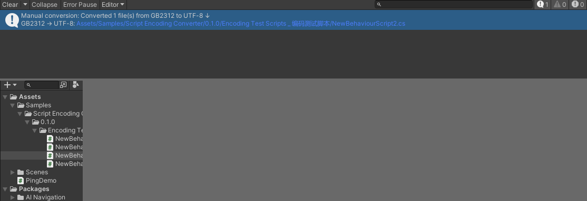
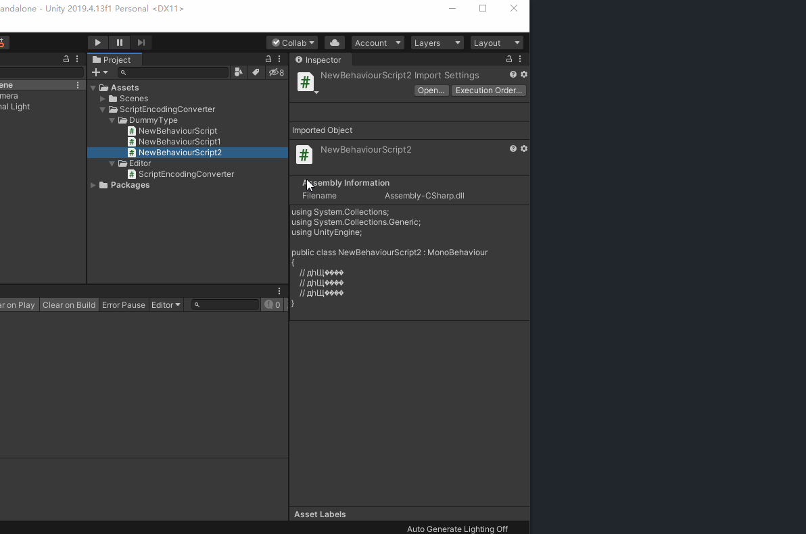

# Script Encoding Converter (com.mud.modules.script-encoding-converter)

> **出处与致谢 / Attribution**
>
> 本包是 [MUDV587/Script-Encoding-Converter](https://github.com/MUDV587/Script-Encoding-Converter)（原作者 **Bian Shanghai / Bian-Sh**，MIT 协议）的**优化改进版**，由 **MUD** 维护。上游的版权声明保留于 [LICENSE](LICENSE)；本包的全部改动见下方「优化改进 / Improvements」与 [CHANGELOG.md](CHANGELOG.md)。
>
> This package is an **improved and optimized derivative** of [MUDV587/Script-Encoding-Converter](https://github.com/MUDV587/Script-Encoding-Converter) by **Bian Shanghai / Bian-Sh** (MIT). MUD maintains this distribution. The upstream copyright is retained in [LICENSE](LICENSE); all changes are listed below and in [CHANGELOG.md](CHANGELOG.md).

> Important: Don't Use it before backup your scripts (usually backup by git)
>
> 重要提示：请在使用前使用 git 提交你的代码

 Editor extension for converting script encoding from GB2312 to UTF8，it's useful.

 这是一个将脚本编码从 GB2312 转换为 UTF8 的编辑器扩展，从某种角度来看，还挺好用！

# Installation / 安装

**本地 `file:` 引用（仓库尚未发布到 GitHub 时）**

在你的项目 `Packages/manifest.json` 的 `dependencies` 中加入（路径按实际存放位置调整，`..` 表示相对项目根目录向上一级）：

```json
"com.mud.modules.script-encoding-converter": "file:../com.mud.modules.script-encoding-converter"
```

**Unity Package Manager (git URL，发布到 GitHub 后)**

包内容即为仓库根，无需 `?path=` 参数：

```json
"com.mud.modules.script-encoding-converter": "https://github.com/<owner>/com.mud.modules.script-encoding-converter.git"
```

可选：锁定到某个 tag（例如 `v0.1.0`）：

```json
"com.mud.modules.script-encoding-converter": "https://github.com/<owner>/com.mud.modules.script-encoding-converter.git#v0.1.0"
```

需要 Unity 2019.4 或更高版本。 Requires Unity 2019.4 or newer.

也可以在 Package Manager 窗口选择 *Add package from git URL...* 粘贴地址安装。

# 优化改进 / Improvements（相对上游 MUDV587/Script-Encoding-Converter）

- **[修复] UTF-16/UTF-32/二进制文件不再被误判为 GB2312 并重写成乱码**：检测到 `0x00` 字节即判为「无法识别」，所有入口（手动转换 / Auto Fix / Preview）一律跳过并报警。上游中 BOM 以外的 UTF-16LE 中文脚本会严格解码为 GB2312，从而被"成功转换"为乱码。
- **[修复] 备份会话目录加毫秒 + 冲突去重**：上游按秒命名，同一秒内的两次批量转换会互相覆盖备份。
- **[修复] `IsReadOnlyPackageAsset` 相对项目根解析**，不再依赖进程工作目录。
- **[修复] Auto Fix 重导入后不再重复入队**（`AssetDatabase.Refresh()` 期间临时抑制回调），且空批次不再创建空备份目录。
- **[修复] `To GB2312` 跳过纯 ASCII / 空文件**（原行为是无意义的原样重写并消耗备份）。
- **[性能] 单次读盘的 `ProbeFileEncoding`**：手动菜单 / Preview / Auto Fix 失败路径原来对同一文件读 2~3 次盘。
- **[修复] Console 超链接反射钩子（Unity < 2021.1）加保护**，签名不匹配不再每次 domain reload 刷错。
- **[修复] 设置页 `labelWidth` 保存/恢复**，不再污染其他编辑器；`pendingFiles` 去重。
- **[包] 移除 `com.unity.test-framework` 依赖**（测试通过测试 asmdef 引用即可）。
- **[CI] validate 工作流扩展**：包内所有文件的 `.meta` 完整性 + GB2312 演示样本未被 git 重编码的校验。
- **[工程] `Bian.ScriptEncodingConverter` 命名空间、程序集与引用全部重命名为 `MUD.Modules.ScriptEncodingConverter`**，包名 `com.mud.modules.script-encoding-converter`，作者 MUD。

完整细节见 [CHANGELOG.md](CHANGELOG.md)。

# Migrating from the old Assets layout / 从旧版 Assets 目录迁移

旧版本以「拷贝整个仓库的 `Assets/ScriptEncodingConverter/` 目录到项目」的方式分发。迁移到包版需要做一次手动清理：

1. 先 `git commit` 备份（转换/删除文件都是不可逆操作，虽然本包所有转换都有备份副本）。
2. **删除 `Assets/ScriptEncodingConverter` 整个目录**（包括 `.meta`）。旧目录里若有你自己改过的代码，请先手动合并。
3. 按上面的 Installation 章节安装包。
4. 重新打开工程并确认：
   - Package Manager 里出现 `Script Encoding Converter`，Console 无报错；
   - `Assets > Script Encoding Converter` 菜单**只出现一套**（旧复制版会导致菜单重复）。

行为变化：
   - **Auto Fix 不使用 EditorPrefs**，改为**按项目配置**：Project Settings → `Script Encoding Converter` 页签，默认**关闭**，建议把生成的 `ProjectSettings/ScriptEncodingConverter.asset` 提交到 git；
   - **Backup 默认开启**，转换前会把原文件备份到 `<temp>/ScriptEncodingConverterBackups/<project name>/<时间戳>/`（可在设置页签修改/打开目录）；
   - 批量转换完成后**一次性 `AssetDatabase.Refresh()`**，不再逐文件重导入；
   - 报告日志**统一为英文**。

# Configuration / 配置

`Project Settings > Script Encoding Converter` 页签（资产会存到 `ProjectSettings/ScriptEncodingConverter.asset`，建议提交到 git）：

| 设置 | 默认值 | 说明 |
|---|---|---|
| Auto Fix | 关闭 | 导入/移动匹配的文本资产时自动转 UTF8 |
| Backup | 开启 | 转换前把原文件镜像备份到时间戳目录，可用 "Open Backup Directory" 打开 |
| Backup directory | 空 | 空 = `<temp>/ScriptEncodingConverterBackups/<project name>`；支持相对/绝对路径 |
| Supported Extensions | 见代码 | **完全接管**：列表就是全部生效规则，手动转换/Auto Fix/Preview 共用 |

# Supported file types / 支持的文件类型

默认：`.cs`、`.shader`、`.cginc`、`.hlsl`、`.compute`、`.asmdef`、`.uxml`、`.uss`、`.txt`、`.md`（大小写均可）。选中文件夹时会递归处理其中的支持文件；可在设置页签增删。

Default: `.cs`, `.shader`, `.cginc`, `.hlsl`, `.compute`, `.asmdef`, `.uxml`, `.uss`, `.txt`, `.md` (case-insensitive). Selecting a folder recursively processes supported files inside it; the list can be edited in the Settings page.

> 说明：`To GB2312` 遇到无法用 GB2312 表示的字符（如 emoji、生僻字）时，该文件会被跳过并在 Console 报警，**不会**被写成 `?`。
> Note: `To GB2312` skips a file (with a warning in the Console) when a character has no GB2312 representation, e.g. emoji or rare CJK characters — it will never be silently replaced with `?`.

# Features / 功能

1. Project 窗口单/多选文件、文件夹选中进行编码转换（**Preview 菜单**可先干跑查看受影响范围，不写盘）

   Convert a selection of files/folders; use `Assets > Script Encoding Converter > Preview` to dry-run and see what would happen without modifying anything.

2. Auto Fix：导入/移动支持的文本资产时自动转 UTF-8（**按项目配置，默认关闭**）

   Auto Fix converts supported text assets on import/move. Configured per project in Project Settings; **disabled by default**.

3. **转换前自动备份**（默认开启；可配置目录；备份失败=不覆写原文件）

   Original files are backed up before every conversion (enabled by default). If the backup fails, the file is left untouched.

4. 有效的 UTF8 断言

   A simple but effective way to check whether a script is Encoding.utf8 or not.

5. 可在控制台输出的报告中点击脚本路径以便 Ping/高亮 脚本资产（报告只在实际发生转换/失败/无法识别时打印）

   Clickable file paths in the Console report ping the asset in the Project window. Report is printed only when there is something to report.

    

    **GIF / 动画**

    

    **Tips:**
* 演示了单文件、多文件 UTF8 - GB2312 互相转换

   Demonstrated the single file multi - file UTF8 - GB2312 conversion

* 演示了脚本被修改后自动修改 编码为 UTF8

   Demonstrates that the script is automatically changed to UTF8 after being modified

# Running the tests / 运行测试

在开发仓库中打开 `Window > General > Test Runner`，选择 **EditMode**，运行 `MUD.Modules.ScriptEncodingConverter.Tests.Editor` 测试程序集（检测 + 转换 roundtrip + 备份 + 写盘失败原文件不变 + UTF-16 回归 等用例）。

In this development repository: open `Window > General > Test Runner`, select **EditMode** and run the `MUD.Modules.ScriptEncodingConverter.Tests.Editor` assembly.

# Limitations / 已知局限

- A BOM-less UTF-8 file whose Chinese bytes are all valid strict-GB2312 sequences is indistinguishable from GB2312 and will be skipped. Add a BOM or convert such a file once manually.
- 不含 BOM 的 UTF-8 中文文件，若其字节序列恰好都能被严格 GB2312 解码，则无法与 GB2312 区分，会被跳过。遇到请手动转换或加 BOM。
- 含 NUL 字节的文件（UTF-16/UTF-32/二进制）一律跳过（报「无法识别」），本工具不做 UTF-16 转码。
- Files containing NUL bytes (UTF-16/UTF-32/binary) are always skipped as unidentified — this tool does not transcode UTF-16.

# Summary / 结语

 这个组件对脚本中有汉字的人会有帮助，它解决了某些情况下脚本编码会变成 GB2312 导致 Unity 识别异常的问题，异常表现为要么 Inspector 上可见乱码，要么 log 信息中出现乱码。

  This plugin would be helpful when script contains some Chinese characters. It solves the problem that in some cases the script will become a GB2312 Encoding and cause Unity  recognize abnormality. The details of the abnormality can be seen on the Inspector,as well as in the log context.

> 脚本使用的 UTF8 编码不管有没有 Bom 均可使用本工具。
>
> utf-8 bom and utf-8 can use this tool.
